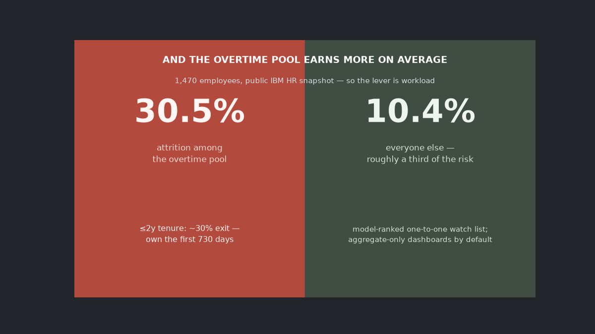
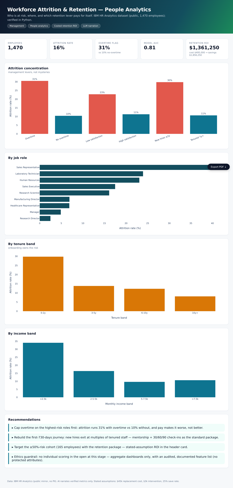

# To: HR Director — attrition levers, priced



Public IBM HR Analytics dataset, 1,470 employees, no real PII. Question on the
table: *who is at risk, where does attrition concentrate, and which lever pays
for itself?*

## TL;DR

Overtime is the sharpest, most counterintuitive flag — leavers from the overtime
pool exit at **30.5%** vs **10.4%** for everyone else, *and they earn materially
more on average* (the `income_gap` KPI). If money motivated them, the salary
panel wouldn't look like that. **The lever is workload, not wages.** Second: the
first two years — **~30%** of early-tenure employees exit vs ~11% for 7y+ staff.

## Levers, measured

| lever | attrition among flagged | among others |
|---|---|---|
| overtime | **30.5%** | 10.4% |
| satisfaction floor | 22.8% | 11.3% |
| tenure ≤ 2 years | 29.8% | (tenured 7y+: 10.7%) |

## The model & the watch list

GBDT + an interpretable logistic readout (AUC in `model.json`), stratified split.
Every employee scored → **≥50%-risk cohort** sized → `outputs/employee_risk.csv`
→ the chat's "top 5 at risk" command returns the ranked one-to-one candidates.

## The cost math (stated, conservative)

Replacement $45k, retention package $3k, 25% save rate → net-positive under those
assumptions; the numbers live in `model.json` and rerun on edit. Calibrate to
your org before circulating.



## Try it

```bash
python3 -m venv .venv && .venv/bin/pip install -r requirements.txt
.venv/bin/python src/00_download_data.py     # data also in data/raw
.venv/bin/python src/01_analysis.py          # levers + segments
.venv/bin/python src/02_model_retention.py   # scores the watch list
.venv/bin/python src/04_dashboard.py         # dashboard/index.html
.venv/bin/python src/05_banner.py            # banner above

.venv/bin/python src/06_chat.py "top 5 at risk"    # ranked 1:1 candidates
.venv/bin/python src/06_chat.py "overtime"        # the 30.5/10.4 split
.venv/bin/python src/06_chat.py
```

Answers (levers, overtime, satisfaction floor, tenure buckets, departments,
income gap, the ranked watch list) are recomputed from project files at question
time. `GROQ_API_KEY` → LLM narration of verified facts including an ethics note;
without the key, the deterministic engine gives the same numbers.


## Ethics + limits

Snapshot data: no exit interviews, no leaver dates. Model excludes protected
attributes. Individual risk scores stay behind a governance review — the
aggregate-only dashboard is what this repo publishes, and `03_ai_insights.py` is
prompted to say so. The cost assumptions need a real compensation base before
any dollar figure circulates.
